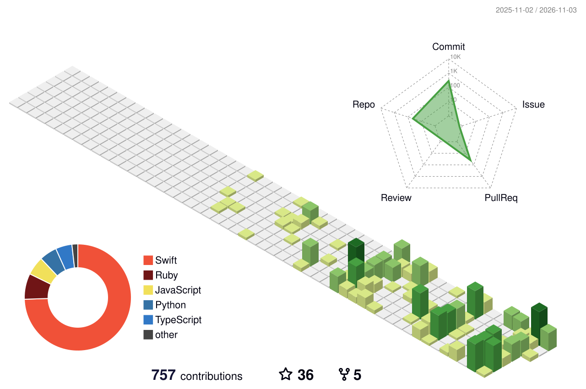

<picture>
  <source media="(prefers-color-scheme: dark)" srcset="assets/header-dark.svg">
  
</picture>

Engineer and founder. I build hardware, firmware and the software around it: native macOS tools, ESP32 devices, flight telemetry, and AI agents that take the manual work out of running a hardware business.

Building at [**Fracktal Works**](https://github.com/FracktalWorks) (3D printers and manufacturing) and **Hathi Labs**.

<picture>
  <source media="(prefers-color-scheme: dark)" srcset="profile-3d-contrib/profile-night-rainbow.svg">
  
</picture>

## Shipped

#### `SW` macOS tools
Install any of them with <code>brew install --cask ishaanpilar/tap/&lt;app&gt;</code>

| | |
|---|---|
| [**CopyWatch**](https://github.com/ishaanpilar/CopyWatch) | Verified, resumable file backups for filmmakers |
| [**PowerTools AI**](https://github.com/ishaanpilar/PowerTools) | My Mac utilities in one menu-bar app, with AI built in |
| [**MacTelemetry**](https://github.com/ishaanpilar/MacTelemetry) | Thermal pressure, CPU and memory in the menu bar, with live graphs |
| [**CloseQuit**](https://github.com/ishaanpilar/CloseQuit) | Closing an app's last window quits it. A 2.9 MB daemon with no UI |
| [**MultiPrint**](https://github.com/ishaanpilar/MultiPrint) | Double-sided printing on printers that can't do it themselves |
| [**WhereFrom**](https://github.com/ishaanpilar/MacOSWhereFrom) | See where every file came from, then group, dedupe and tidy |
| [**Claude Code Switcher**](https://github.com/ishaanpilar/claude-code-switcher) | Share a pool of Claude accounts across a small team |

#### `U` Hardware & firmware

| | |
|---|---|
| [**Bambu Status Bar**](https://github.com/ishaanpilar/BambuLab-StatusBar-LED)  | ESP32 LED status bar for Bambu Lab printers, flashed from the browser |
| [**Serina**](https://github.com/ishaanpilar/Serina) | Voice AI desk companion on ESP32-S3 with animated OLED eyes |
| [**SimPanel Button Box**](https://github.com/ishaanpilar/SimPanel-Button-Box-v1) | 25-button, 4-encoder USB gamepad for sim racing and flight sims |
| [**Button Box Planner**](https://github.com/ishaanpilar/HID-Button-Box-Matrix-Planner) | Control count in; wiring diagram and Arduino sketch out |
| [**Arduino Serial Namer**](https://github.com/ishaanpilar/arduino-serial-device-namer) | Names for USB-serial boards that survive macOS port shuffling |
| [**NextBoot**](https://github.com/ishaanpilar/NextBoot-Manager) | Reboot straight into another OS using UEFI `BootNext` |

#### `Q` AI & agent tooling

| | |
|---|---|
| [**mcp-slim-proxy**](https://github.com/ishaanpilar/MCP-Tool-Shimming) | MCP proxy that cuts tool-schema context by up to 93% |
| [**AI-DriftLint**](https://github.com/ishaanpilar/AI-DriftLint-Project) | One `AGENTS.md` synced to every agent's rules file; CI fails on drift |
| [**pristine**](https://github.com/ishaanpilar/pristine) | AI dust and scratch removal that leaves 98% of the frame untouched |

#### `R` Manufacturing, media & ops

| | |
|---|---|
| [**ArduPilot diff all**](https://github.com/ishaanpilar/ardupilot-diff-all) | Show only the parameters you changed from firmware defaults |
| [**MoonrakerFleet**](https://github.com/ishaanpilar/MoonrakerFleet) | Cost and success analytics across a fleet of Klipper printers |
| [**Marker Importer**](https://github.com/ishaanpilar/Client-Video-Edit-Reviewer-XML-Timestamp-Generator) | Client video notes to Premiere, Resolve and Final Cut markers |
| [**FinalOutput**](https://github.com/ishaanpilar/finaloutput-batch-exporter) | Delivery spec sheet in, every correctly named deliverable out |
| [**ShopiCat**](https://github.com/ishaanpilar/ShopiCat) | Any Shopify store to a print-ready catalog PDF |
| [**RazorpayRecon**](https://github.com/ishaanpilar/RazorpayRecon) | Match Razorpay settlements to orders, entirely in the browser |

## Behind closed doors

Private and client work, described without the confidential parts:

- **Flight data analysis:** offline replay and briefing suite for helicopter operations
- **Manufacturing SaaS:** MES, MRP and constraint-based scheduling for mid-sized factories
- **Compliance:** EU Cyber Resilience Act desk for small hardware makers
- **Trading:** cost-aware portfolio system and broker MCP server for Indian markets
- **Business automation:** RAG sales assistant, GST invoice auto-filing, PLC machine control
- **Personal ops:** WhatsApp and email triage hub, plus a weekly business-idea research pipeline
- **Web:** sites and stores for brands in film, lighting, aerial cinematography and 3D-printed goods

## Toolbox

